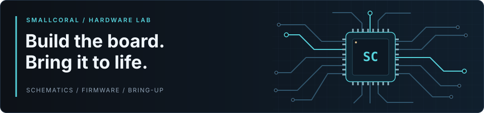
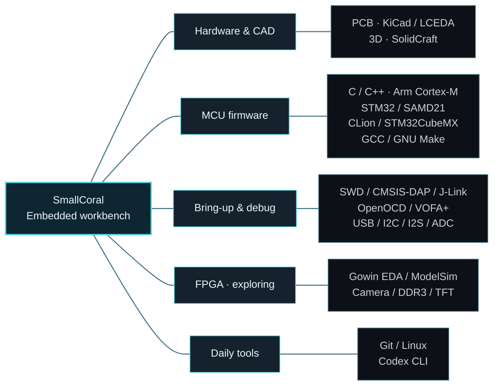

  

# SmallCoral · 小珊瑚

**Embedded hardware · PCB design · MCU firmware**

I'm a Communication Engineering undergraduate building custom boards and the firmware that brings them to life. My work spans modular STM32 boards, USB audio, and sensor interfaces, from schematic capture to board bring-up.

[][smallcoral]  [][jlc] [][bilibili]

## Selected hardware

### Coral-C5 · Modular STM32 boards

A board family built around **STM32C5A3**: a core board, an expansion board, and a dual-motor robotics expansion. I’m working on the hardware as a modular platform for embedded experiments.

**Status:** In development. The repository is currently private; expansion-board work is ongoing.

### [Coral-Wave](https://github.com/SmallCoral/Coral-Wave) · USB audio interface

**ATSAMD21E18A + WM8978**, with custom KiCad hardware, MCU firmware, and a Windows control utility. It supports stereo playback and mono microphone capture at **48 kHz / 16 bit**, with EQ, gain controls, and saved presets.

**Status:** Headphone playback, microphone capture, and USB firmware updates have hardware test records. Analog performance measurements remain open.

[Hardware & PCB](https://github.com/SmallCoral/Coral-Wave/blob/main/docs/hardware.md) · [Firmware & flashing](https://github.com/SmallCoral/Coral-Wave/blob/main/docs/firmware.md) · [Test records](https://github.com/SmallCoral/Coral-Wave/blob/main/docs/testing.md)

### [FluxDial](https://github.com/SmallCoral/FluxDial) · Temperature & flow monitor

An **STM32C562** board reading an NTC temperature probe and a Hall-effect flow sensor, with a round LED display. The project combines sensor acquisition, pulse timing, display driving, and fault handling.

**Status:** Temperature sampling and on-board pulse tests have hardware records. Water-flow calibration and PCB checks are still in progress.

[Hardware](https://github.com/SmallCoral/FluxDial/blob/master/docs/hardware.md) · [Firmware](https://github.com/SmallCoral/FluxDial/blob/master/docs/firmware.md) · [Validation](https://github.com/SmallCoral/FluxDial/blob/master/docs/validation.md)

## Software & technical stack

My tools follow the path from board design to firmware, bring-up, and verification. FPGA video pipelines are an area I'm exploring.

More experiments

- **FPGA Robot:** A camera → DDR3 → 480 × 272 TFT video pipeline; Ethernet debugging and LD06 LiDAR obstacle avoidance are in development.
- **CMSIS-DAP v2 probe:** A compact STM32F042 SWD probe, with USB enumeration and OpenOCD connectivity tested.

## GitHub activity

  
  

Repository data covers public, non-fork repositories. Language shares measure code bytes, not time spent or proficiency. Cards are generated in this repository with GitHub Actions.

[More activity on GitHub](https://github.com/SmallCoral?tab=overview)

Beyond the bench · writing, videos & a little gaming

I help run student ACM and electronics associations. Outside the lab, I enjoy amateur radio, networking, marine technology, Minecraft, and Hollow Knight.

- [使用 CLion 结合 CubeMX 进行嵌入式开发](https://www.bilibili.com/video/BV1zpwhejExe/)
- [乐意效劳，但是 MC【2025 Minecraft 新春会单品】](https://www.bilibili.com/video/BV1daFnerENK/)
- [红黑双亡怒杀穿竞技场 3](https://www.bilibili.com/video/BV1qtknYYEqn/)

[CSDN][csdn] · [Steam][steam] · [More videos][bilibili]

---

Have a board or an embedded project to discuss? **[Shan_Hu_MC@outlook.com](mailto:Shan_Hu_MC@outlook.com)**

[smallcoral]: https://smallcoral.github.io
[bilibili]: https://space.bilibili.com/517434964
[csdn]: https://blog.csdn.net/Shan_Hu_MC
[jlc]: https://oshwhub.com/smallcoral/project_oklgidzn
[steam]: https://steamcommunity.com/id/smallcoral
