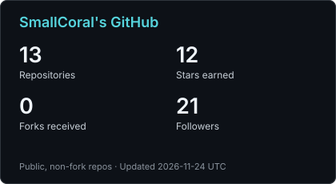
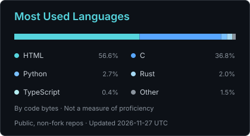

  

# SmallCoral · 小珊瑚

I'm a Communication Engineering undergraduate building embedded hardware and firmware, from PCB design to board bring-up.

[Website](https://smallcoral.github.io) · [Email](mailto:Shan_Hu_MC@outlook.com) · [OSHWHub](https://oshwhub.com/smallcoral/project_oklgidzn) · [Bilibili](https://space.bilibili.com/517434964)

## Projects

- **Coral-C5** — STM32C5A3 core board with general-purpose and dual-motor expansion boards. In development.
- **[Coral-Wave](https://github.com/SmallCoral/Coral-Wave)** — USB audio interface built with the SAMD21 and WM8978, with stereo playback and microphone capture.
- **[FluxDial](https://github.com/SmallCoral/FluxDial)** — STM32C562 temperature and flow monitor with a round LED display.

## Tools

C/C++ · STM32 · SAMD21 · KiCad · LCEDA · OpenOCD · Git · Linux

Other projects

- **FPGA Robot** — Camera-to-TFT video pipeline using DDR3, with LD06 LiDAR for obstacle avoidance.
- **CMSIS-DAP v2** — STM32F042-based SWD debug probe tested with OpenOCD.

GitHub activity

