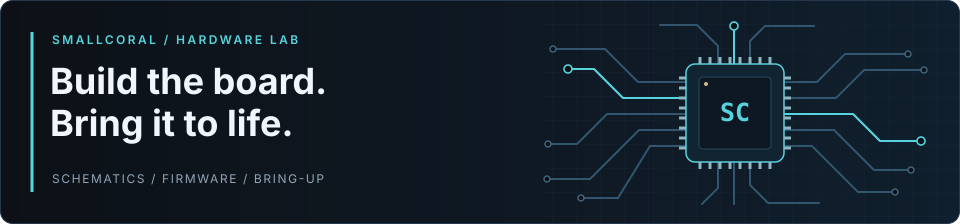
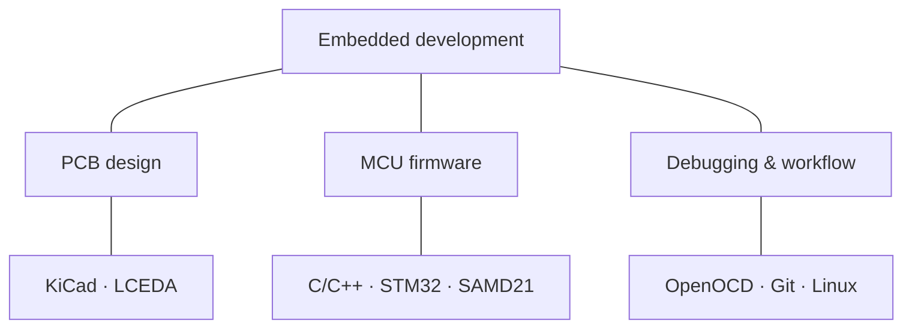

  

# SmallCoral · 小珊瑚

I'm a Communication Engineering undergraduate building embedded hardware and firmware, from PCB design to board bring-up.

[Website](https://smallcoral.github.io) · [Email](mailto:Shan_Hu_MC@outlook.com) · [OSHWHub](https://oshwhub.com/smallcoral/project_oklgidzn) · [Bilibili](https://space.bilibili.com/517434964)

## Tools

