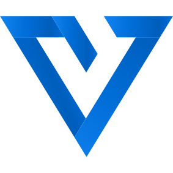
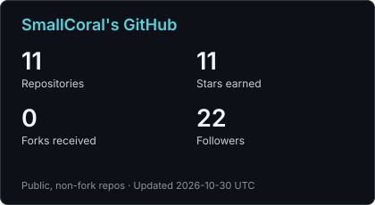

# Hi there, I'm SmallCoral — aka [小珊瑚][smallcoral] 👋

### 👩‍💻 About Me

- 🏫 I'm a Communication Engineering undergraduate student.
- 🔧 I build embedded hardware, write MCU firmware, and bring custom boards to life.
- 🌱 Currently exploring STM32, ARM Cortex-M, FPGA video pipelines, and Linux.
- 🧩 I design PCBs with KiCad and LCEDA, from schematics to board bring-up.
- 🤝 I help run student ACM and electronics associations.
- 📡 Outside the lab, I enjoy amateur radio, networking, marine technology, Minecraft, and Hollow Knight.
- 📫 Reach me at **[Shan_Hu_MC@outlook.com](mailto:Shan_Hu_MC@outlook.com)**.

### 🌐 Connect with me

[][bilibili]
[][csdn]
[][jlc]
[][steam]

[Personal website][smallcoral] · [Open hardware on OSHWHub][jlc]

### 🛠️ Languages and Tools

  &nbsp;&nbsp;
  &nbsp;&nbsp;
  &nbsp;&nbsp;
  &nbsp;&nbsp;
  &nbsp;&nbsp;
  &nbsp;&nbsp;
  &nbsp;&nbsp;
  &nbsp;&nbsp;
  

I also work with **STM32CubeMX, OpenOCD, GCC, Gowin EDA, ModelSim, Git, and Codex CLI**.

### 🔨 Currently building

- **[Coral-C5](https://github.com/SmallCoral/Coral-C5)** — A modular STM32C5A3 board family with a core board, an expansion board, and a dual-motor robotics expansion. Core PCB DRC is clean; expansion-board work is ongoing.
- **[Coral-Wave](https://github.com/SmallCoral/Coral-Wave)** — A USB audio interface using ATSAMD21E18A and WM8978, with a Windows control utility. Playback and microphone capture have been tested on hardware at 48 kHz.
- **FPGA Robot** — A camera → DDR3 → 480 × 272 TFT video pipeline, with Ethernet debugging and LD06 LiDAR obstacle avoidance in development.
- **CMSIS-DAP v2 Debug Probe** — A compact STM32F042 SWD probe, with USB enumeration and OpenOCD connectivity tested.

---

### 📊 Cool Charts

Public repositories only; forks are excluded. Language shares measure code bytes, not time spent or proficiency.

[More activity on GitHub](https://github.com/SmallCoral?tab=overview)

### 📺 On bilibili

- [如何使用 Clion 结合 CubeMX 更优雅地进行嵌入式开发](https://www.bilibili.com/video/BV1zpwhejExe/)
- [乐意效劳，但是 MC【2025 Minecraft 新春会单品】](https://www.bilibili.com/video/BV1daFnerENK/)
- [这才是真正的虚空神之愤怒！红黑双亡怒杀穿竞技场 3](https://www.bilibili.com/video/BV1qtknYYEqn/)

[More videos →][bilibili]

[smallcoral]: https://smallcoral.github.io
[bilibili]: https://space.bilibili.com/517434964
[csdn]: https://blog.csdn.net/Shan_Hu_MC
[jlc]: https://oshwhub.com/smallcoral/works
[steam]: https://steamcommunity.com/id/smallcoral
